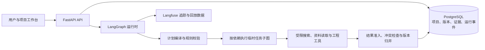

# Aidison

> 面向无人机选型与复杂 DIY 工程的长期决策 Agent。它把分散资料、模块依赖、多轮需求变更和可追溯方案沉淀为一个可以持续推进的工程项目。

[](https://github.com/aluochiyou/aidison/actions/workflows/ci.yml)

Aidison 不是“问一次、答一次”的聊天机器人。一个项目可以跨多轮讨论持续演进：研究任务会在约束校验后被执行，过程中的候选、证据与失败结论会按模块保存，只有满足覆盖与一致性要求的结果才会形成新的正式方案版本。

## 解决的问题

- 长期工程任务的需求会变化，历史方案不能靠覆盖式保存；
- 电池、电机、飞控、机架等模块彼此耦合，单点结论不能脱离约束独立决策；
- 搜索、网页资料和工具调用存在噪声、失败及外部副作用，不能仅相信模型文本；
- 长任务中断后，需要恢复可信的运行状态，而不是从头重新研究。

## 架构



## 核心能力

| 能力 | 做法 |
| --- | --- |
| 项目版本治理 | 使用 PostgreSQL 保存需求修订、稳定模块身份、研究记忆和正式方案；运行检查点与领域事实分权管理。 |
| 受约束的 Agent 编排 | 模型先提出任务草案，Pydantic 和 NetworkX 校验任务结构、依赖环、工具权限与预算，再由 LangGraph 运行。 |
| 模块化研究记忆 | 任务按模块加载历史候选、证据和已排除方案，减少重复搜索，同时保留来源与结论的关联。 |
| 证据与副作用治理 | 将 URL 规范化、内容哈希和原文片段绑定到结论；工具调用记录意图、执行与回执，支持恢复与审计。 |
| 可观测与评测 | 记录运行事件、调用台账和可回放轨迹；可选接入 Langfuse 观察模型与工具链路。 |

## 技术栈

- 后端：Python、FastAPI、SQLAlchemy、Alembic、Pydantic、PostgreSQL
- Agent Runtime：LangGraph、asyncio、NetworkX
- 前端：Next.js、TypeScript、Tailwind CSS
- 工程化：Docker Compose、GitHub Actions、Caddy、Cloudflare Tunnel、Langfuse

## 本地启动

前置条件：Docker Desktop（或 Docker Engine + Compose）、Git。模型与外部资料能力仅在配置对应 API Key 后启用。

```bash
git clone https://github.com/aluochiyou/aidison.git
cd aidison/app
cp .env.example .env
docker compose up --build -d
docker compose ps
```

打开 <http://localhost:3000>。默认 API 健康检查为 <http://localhost:8000/health>。

`.env` 仅保存本机密钥，绝不能提交。最小运行通常只需要数据库配置；接入模型、网页搜索或网页读取时，按 [`app/.env.example`](app/.env.example) 填写相应的 API Key。

## 验证

```bash
cd app
uv run ruff check src tests
uv run mypy src
uv run pytest -q
uv run alembic check

cd web
yarn test
yarn format:check
yarn lint
yarn build
```

GitHub Actions 会在 `app/**` 变更时执行后端测试、前端构建与生产镜像配置校验。

## 生产部署

生产配置位于 [`app/compose.production.yaml`](app/compose.production.yaml)，运维说明位于 [`app/ops/README.md`](app/ops/README.md)。推荐将主机置于 Cloudflare Tunnel 后方，并在 Caddy 与 Cloudflare Access 中启用访问控制；不要直接把 PostgreSQL 或开发端口暴露到公网。

部署前需要由部署者自行准备域名、Cloudflare Tunnel Token、访问密码哈希和模型供应商 API Key。示例变量见 [`app/.env.production.example`](app/.env.production.example)。

## 仓库边界

公开仓库只保留可运行的 `app/` 工程、CI 与本 README。个人调研、面试材料、历史交接、临时输出、第三方源码镜像及 Agent 工作目录均为本地资料，不参与发布。
